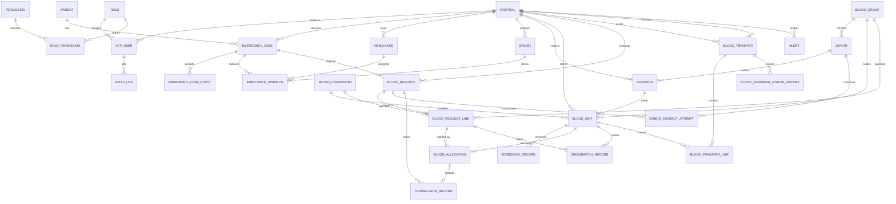

# LIFELINK — Integrated Emergency Response and Blood Resource Management System

## Cover page

**Academic project report**  
**Degree:** BTech Computer Science Engineering  
**Project:** LIFELINK  
**Stack:** Python Flask, MySQL 8.0+, HTML, CSS, JavaScript  
**Status:** Locally runnable academic prototype. The local MySQL connection and 33 automated regression tests have been verified; complete operational workflows and a public deployment remain to be verified separately.

## Abstract

LifeLink is a web application for coordinating emergency cases, ambulance dispatch, hospital resources, blood inventory, donor contact and inter-hospital transfers. Its relational model links every blood request to an emergency and tracks requests down to individual component units. Flask provides authenticated workflows and MySQL stores operational records, event history and audit entries. Availability, pending quantities and shortages are calculated from eligible units and active allocations rather than duplicated counters. The application records entered screening information but does not make clinical compatibility or diagnosis decisions.

## Introduction

Emergency response work requires multiple organizations and resources to coordinate around a case. Disconnected lists make it difficult to know which case requested a resource, whether a unit is still available, or what response actions have happened. LifeLink provides a student-scale centralized system with explicit relations between patients, cases, hospitals, dispatches, requests, donors, donations, blood units and transfers.

## Problem statement and objectives

The project addresses the difficulty of tracking emergency response and blood-resource workflows across hospitals. Its objectives are to register and track emergencies, dispatch ambulances, record donor and donation information, track individually screened blood components, calculate shortages, coordinate donor contact, allocate units transactionally, transfer units between hospitals and retain an audit trail.

## Scope

The system is an academic operational demonstration using synthetic seed data. It includes role-based accounts, patient/case management, ambulance and driver records, inventory, screening and crossmatch records, emergency-linked requests, donor coordination, partial allocation, transfers, alerts, reports and audit history. It does not automate medical decisions, diagnose patients, determine clinical compatibility, or verify actual hospital/donor data.

## Requirements analysis

In the standard configuration, approved staff sign in to access role-protected workflows. A local-only academic demo option can open operational workspaces without sign-in and should be disabled for role demonstrations and all production use. Authorized staff can create, inspect, update and appropriately deactivate/cancel records. The system validates identifiers and relationships, uses parameterized queries, applies CSRF checks to POST requests, stores password hashes, and uses database transactions for unit allocation and transfer state changes. The UI provides search/filter and paginated record lists where applicable. See the repository README and presentation guide for setup and demo instructions.

## ER diagram

The diagram is a conceptual view; `schema.sql` is authoritative for exact columns and constraints.

## Relational schema

The SQL schema consists of `hospital`, `role`, `permission`, `role_permission`, `app_user`, `patient`, `emergency_case`, `emergency_case_event`, `ambulance`, `driver`, `ambulance_dispatch`, `blood_group`, `blood_component`, `donor`, `donation`, `blood_unit`, `screening_record`, `blood_request`, `blood_request_line`, `blood_allocation`, `crossmatch_record`, `donor_contact_attempt`, `blood_transfer`, `blood_transfer_unit`, `blood_transfer_status_history`, `alert`, `audit_log` and `transfusion_record`. Surrogate primary keys are used for entities; the role-permission and transfer-unit junctions use composite keys. Unique business references and foreign keys preserve identity and referential integrity. See `schema.sql` for executable DDL.

## Database design and normalization

**1NF:** Each attribute contains one value. Repeated request products, test results, contact attempts, transfer units and status events are represented as separate rows.

**2NF:** Junction entities describe the full relationship represented by their key. Request lines store requested product/quantity; transfer-unit links identify the whole transfer/unit pairing.

**3NF:** Patient, hospital, donor, role, group and component descriptions are stored once and referenced by keys. Derived pending and shortage amounts are calculated rather than maintained as duplicate editable facts.

## SQL implementation (DDL, DML, DQL, TCL, DCL)

- **DDL:** `schema.sql` creates the database and tables with keys, checks, indexes and constraints.
- **DML:** `seed.sql` inserts only synthetic example records; `INSERT IGNORE` and conditional inserts make the demo load repeatable. Setup skips seeding when it detects existing operational records.
- **DQL:** `queries.sql` contains 25 read-only MySQL queries. They can be run after database initialization. Their expected output descriptions are included below.
- **TCL:** Allocation and transfer changes are committed or rolled back by Flask transaction boundaries. A simple SQL transaction example is `START TRANSACTION; SELECT blood_unit_id FROM blood_unit WHERE inventory_status='available' FOR UPDATE; ROLLBACK;` (read-only locking demonstration; run only against a disposable/demo database).
- **DCL:** Database grants should be provisioned by the local MySQL administrator for a least-privilege project account, for example `GRANT SELECT, INSERT, UPDATE, DELETE, CREATE, ALTER, INDEX, REFERENCES ON lifelink.* TO 'lifelink_app'@'localhost';`. This is an administrative example and was not executed by this project setup.

## Query guide and expected outputs

Run `queries.sql` after initializing and seeding MySQL. Every statement is read-only and executable as written. Results depend on current database contents; descriptions give the result shape, not fabricated rows.

1. Hospitals: one row per hospital with code, name, city and active state.
2. Emergency cases: case reference, patient, receiving hospital, status and priority.
3. Active case count by status: one aggregate row per case status present.
4. Patient case history: patients with zero or more linked cases.
5. Ambulance fleet by hospital/status: one aggregate row per combination.
6. Dispatch tracking: dispatch reference context, vehicle, driver and timestamps.
7. Donor directory: donor reference, recorded group, city and availability.
8. Donations per donor: donor and donation count, including donors with none.
9. Blood-unit inventory by hospital/group/component/status: unit counts by category.
10. Eligible stock estimate: exact recorded group/component count after expiry, screening, allocation and active transfer exclusions.
11. Expiring units: unexpired units through the next 30 days.
12. Requests with required/allocated/pending totals: one row per request line.
13. Shortage candidates: request lines where local eligible units are below pending units.
14. Request progress: required, active allocated and pending totals grouped by request.
15. Donor contact history: each contact attempt with donor and request references.
16. Screening history: tests ordered newest first per unit.
17. Crossmatch history: recorded test entries by request line and unit.
18. Transfer manifests: source/destination, status and count of included units.
19. Transfer milestone history: each state change in chronological order.
20. Open alerts: unresolved alert rows with linked case/request/unit context.
21. Monthly donations: month and count for the current calendar year.
22. Emergency locations by case count: aggregate groups ordered by frequency.
23. Audit activity: latest 100 actions and actor names where available.
24. Transfusion outcomes: request, allocation and outcome state.
25. Requests with no active allocations: request list with zero active assigned units.

The SQL does not encode medical compatibility rules. Query 10 uses the application’s inventory eligibility rule and current MySQL date/time.

## Constraints and transaction rules

Foreign keys protect linked records; restrictive deletes preserve history. Unit and business reference codes are unique. Request quantities are positive; workflow status and alert categories are constrained. The `uq_active_blood_unit_allocation` unique generated key prevents a unit from having more than one active reserved/issued allocation. The application locks candidate inventory rows when allocating or creating transfers, updates state in a transaction and rolls back invalid operations. Eligible inventory excludes expired, reserved, issued, quarantined, discarded, actively transferred, uncleared and already allocated units.

## Screenshots of actual application execution

Screenshots are not embedded in this report. During project preparation, the local dashboard, blood catalog, staff sign-in, emergency, and transfusion pages were opened in a browser; this visual review does not prove every workflow end to end. Automated regression tests use mocks for some write operations. Capture presentation screenshots only after confirming the displayed records are synthetic and contain no private information.

## Conclusion

LifeLink models emergency and resource coordination through MySQL relationships and history. The application includes transactional allocation and transfer handling, eligibility-based inventory calculations, authorization and audit events. Local MySQL connectivity and regression tests passed, but full create-to-resolution workflows, concurrency, and a production deployment remain unverified.

## Future scope

Possible academic extensions include external dispatch interfaces, configurable operational alert thresholds, richer aggregate charts, automated backups and deployment hardening. These would require separate requirements and validation. Clinical decision automation is outside the project scope.

## References

- MySQL 8.0 Reference Manual: https://dev.mysql.com/doc/refman/8.0/en/
- Flask documentation: https://flask.palletsprojects.com/
- Python `mysql-connector-python` documentation: https://dev.mysql.com/doc/connector-python/en/
- LifeLink source of truth: repository `schema.sql`, `seed.sql`, `docs/database_design.md`, `docs/ER_diagram.md`, `docs/testing.md`.
