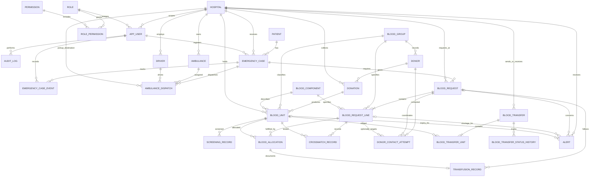

# LifeLink ER diagram

The drawing uses plural display names for readability; physical MySQL names are singular or underscore-delimited as in `schema.sql` (for example, `emergency_case`, `blood_unit`, and `app_user`). `BLOOD_TRANSFER` has source and destination hospital foreign keys. `TRANSFUSION_RECORD.allocation_id` is unique so an issued unit can have at most one demonstration outcome record.
